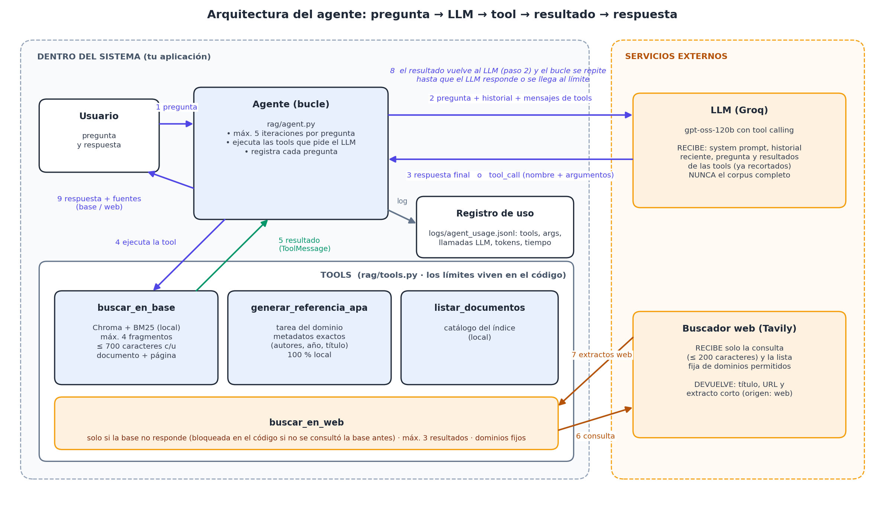
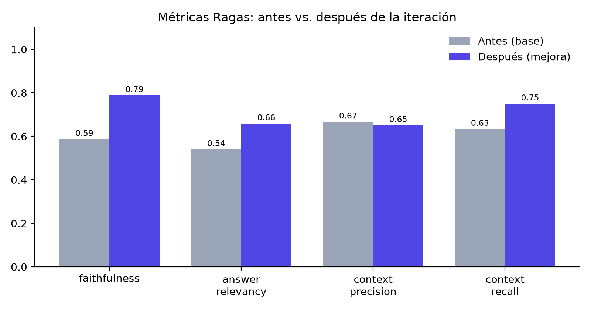

# 🧠 Asistente Experto basado en RAG

Asistente conversacional que responde **únicamente** con la información de una base de conocimientos propia y **cita la fuente** (documento y fragmento) de cada respuesta. Cuando la información no está en el corpus, lo dice en lugar de inventar.

En las consultas normales, primero explica la respuesta con citas del material recuperado y después hace una sola pregunta de seguimiento. Los quizzes y otras herramientas de estudio conservan el formato solicitado.

Las preguntas sobre los temas disponibles o las fuentes del tutor se responden directamente con el catálogo completo del índice, antes de reescribir la consulta o llamar al LLM. Los ejemplos dentro de un PDF no se presentan como temas adicionales del curso.

> **URL pública de la aplicación:** <https://rag-asistente-bdqqdfqfnzl6bymy65mtm2.streamlit.app/>
> **Repositorio:** <https://github.com/damoelrrr/rag-asistente>

**Privacidad:** el sistema conserva el control de la base de conocimientos y del índice vectorial. Los documentos no se entregan a servicios de entrenamiento; los embeddings se calculan **localmente** y al LLM solo se le envían los fragmentos recuperados para cada consulta, nunca el corpus completo.

---

## Avance 3: agente con herramientas

El RAG del Avance 2 ahora es un **agente**: el LLM decide si necesita una herramienta (tool calling), el programa la ejecuta y le devuelve el resultado. Se reutilizan la ingesta, el chunking, el índice Chroma + BM25, el conjunto de evaluación y la interfaz.



### Tools y límites

Todos los límites están escritos en el código ([`rag/tools.py`](rag/tools.py)), no en el prompt: el LLM no puede cambiarlos.

| Tool | Tipo | Qué hace y cuándo se usa | Límites en el código |
|---|---|---|---|
| `buscar_en_base(consulta)` | búsqueda | Recupera fragmentos de los documentos del curso (embeddings + BM25). Se usa para toda pregunta de contenido; una llamada por tema en preguntas compuestas. | Máx. **4 fragmentos** por llamada, **700 caracteres** por fragmento, consulta ≤ 300 caracteres. Cada fragmento lleva documento y página. |
| `generar_referencia_apa(documento)` | tarea del dominio | Devuelve la referencia APA 7 exacta de un documento de la base a partir de sus metadatos (autores, año, título). El LLM extrae de la pregunta el título, archivo o autor. | Solo documentos de la base; si no lo encuentra, devuelve `SIN_RESULTADOS` con la lista de documentos. Nunca genera la referencia "de memoria". |
| `listar_documentos()` | búsqueda | Catálogo de los documentos indexados. Se usa cuando preguntan qué temas o fuentes tiene el tutor. | Máx. 30 documentos. |
| `buscar_en_web(consulta)` | web | Busca en Tavily, solo en sitios permitidos, cuando la base no tiene la respuesta. | Máx. **3 resultados** (título, URL y extracto ≤ 300 caracteres, origen `web`); consulta ≤ 200 caracteres; dominios fijos; **bloqueada si antes no se llamó a `buscar_en_base`**. |

**Bucle** ([`rag/agent.py`](rag/agent.py)): bucle manual con `bind_tools` de LangChain. Máximo **5 iteraciones** por pregunta (`AGENT_MAX_ITERATIONS`); al llegar al límite se obliga al LLM a responder sin más tools. Máximo 3 tools por vuelta. Una tool desconocida o con argumentos inválidos devuelve un error al LLM en lugar de romper la app.

**Prompt** ([`rag/agent_prompts.py`](rag/agent_prompts.py)): ya no lleva el contexto; indica cuándo usar cada tool (y cuándo ninguna: saludos y preguntas ajenas al curso), obliga a responder solo con lo que devuelven las tools, a citar `(Fuente: archivo, pág. N)` o `[web: URL]` y mantiene la respuesta exacta de rechazo. Tres ejemplos few-shot muestran un saludo sin tools, una búsqueda en la base y el paso base → web. Si el modelo cita con la etiqueta interna (`[B1]`, `[W1]`), el código la reemplaza por la cita con su origen.

**Registro de uso** ([`rag/agent_log.py`](rag/agent_log.py)): una línea JSON por pregunta en `logs/agent_usage.jsonl` con las tools llamadas, sus argumentos, el número de llamadas al LLM, las iteraciones, los tokens y el tiempo.

### Política de búsqueda web

- **Cuándo:** solo si `buscar_en_base` ya se consultó y no tiene la respuesta, y la pregunta trata de información pública o actual del dominio del curso (documentación oficial, una definición general, una versión reciente). La regla está en el docstring de la tool y en el System Prompt, y el orden "primero la base" se hace cumplir en el código.
- **Qué sale del sistema:** solo la consulta (≤ 200 caracteres). Nunca fragmentos de la base.
- **Respuesta:** separa "Según la base de conocimientos:" de "Según la web:" y marca cada dato web con `[web: URL]`. La interfaz muestra las fuentes web aparte.

| Sitio permitido | Por qué |
|---|---|
| `arxiv.org` | Artículos científicos originales; el survey de RAG del corpus viene de arXiv. |
| `ollama.com`, `docs.ollama.com` | Sitio y documentación oficial de Ollama (LLMs locales, tema del curso). |
| `docs.langchain.com`, `python.langchain.com`, `langchain-ai.github.io` | Documentación oficial de LangChain/LangGraph, el framework del agente. |
| `docs.trychroma.com` | Documentación oficial de Chroma, el índice vectorial del proyecto. |
| `scikit-learn.org` | Documentación oficial de TF-IDF y recuperación de información. |

La lista se envía fija a Tavily (`include_domains`) y además se vuelve a filtrar al recibir los resultados. El LLM no puede cambiarla. Fuera de estos sitios (o si no hay resultados), el agente responde con el texto de rechazo.

### Evaluación del agente

- **Casos de comportamiento:** 8/8 cumplen (`eval/results/behavior_results.md`): saludo sin tools, pregunta compuesta con dos búsquedas, 2 tareas APA, búsqueda web solo en sitios permitidos, pregunta respondida por la base sin web, instrucción maliciosa rechazada y pregunta fuera de alcance con el texto de rechazo exacto.
- **Ragas:** pipeline fijo actual (gpt-oss-120b): faithfulness 0.77, answer_relevancy 0.45, context_precision 0.61, context_recall 0.67. La corrida del agente agotó la cuota diaria gratuita de Groq antes de puntuarse; `eval/run_agent_eval.py` guarda el avance por pregunta y retoma solo.
- **Costo (mismas preguntas, mismo LLM):** el agente hace 2 llamadas al LLM por pregunta frente a 1 del pipeline y usa ~2× tokens de entrada (`eval/results/cost_comparison.csv`).

## 1. Flujo RAG implementado

```
  Documentos (PDF/DOCX/TXT/MD/HTML)
        │  1. INGESTA          rag/ingest.py
        ▼
  Texto por página/documento
        │  2. CHUNKING         rag/chunking.py   (800 car., solape 120, corte recursivo)
        ▼
  Chunks + metadatos (fuente, página, nº de fragmento)
        │  3. VECTORIZACIÓN    rag/embeddings.py (paraphrase-multilingual-MiniLM-L12-v2, local)
        ▼
  Índice persistente Chroma (coseno)   rag/vectorstore.py   ──►  data/index/
        ▲
        │  5. RECUPERACIÓN     top_k + umbral de distancia
  Pregunta ──► 4. REESCRITURA con historial (preguntas de seguimiento)  rag/pipeline.py
        ▼
  6. GENERACIÓN: system prompt + few-shot + <contexto>…</contexto> + <pregunta>   rag/prompts.py
        ▼
  Respuesta con citas [n] + panel de fuentes   app.py
```

| Etapa | Decisión | Justificación |
|---|---|---|
| Corpus | 7 PDFs del curso *Desarrollo de aplicaciones con IA* (`data/corpus/`): Introducción a RAG, survey *RAG for LLMs* (Gao et al., 2024), TF-IDF y keyword search, BM25, ingeniería de prompts, LLMs locales con Ollama y método socrático | El asistente es un tutor del curso: el corpus cubre justo lo que el estudiante consulta (recuperación, RAG, prompting, LLMs locales y la pedagogía socrática del tutor). Mezcla diapositivas cortas en español con un artículo largo en inglés, lo que justifica un embedding multilingüe |
| Chunking | 800 caracteres, solape 120 (15 %), corte recursivo párrafo → línea → frase → palabra | Suficiente contexto para una idea completa sin mezclar temas; el solape evita cortar ideas en el límite |
| Embeddings | `paraphrase-multilingual-MiniLM-L12-v2` (384 dim) | Multilingüe (español), ligero, corre local y no envía texto a terceros |
| Índice | Chroma persistente, distancia coseno | Open source, embebido, guarda texto + metadatos para citar |
| Recuperación | Búsqueda híbrida: embeddings + BM25, expansión de siglas y fusión de rankings; `top_k=4`, distancia coseno máxima 0.75 | Recupera candidatos adicionales, descarta títulos aislados y bloques bibliográficos, y selecciona hasta 4 fragmentos para el modelo |
| Generación | LLM vía LangChain (Groq `openai/gpt-oss-120b` por defecto; también Anthropic u OpenAI), temperatura 0.1 | Respuestas estables y fieles al contexto |
| Conversación | Reescritura de la pregunta con el historial antes de buscar | Permite preguntas de seguimiento ("¿y su ventaja?") |

## 2. Instalación y ejecución (local)

Requisitos: Python 3.10–3.12 y una clave de API (Groq gratuita en <https://console.groq.com/keys>, o Anthropic/OpenAI).

```bash
python -m venv .venv
# Windows:  .venv\Scripts\activate        macOS/Linux:  source .venv/bin/activate
pip install -r requirements.txt
# crea un archivo .env con: LLM_PROVIDER=groq, GROQ_API_KEY=..., LLM_MODEL=openai/gpt-oss-120b y TAVILY_API_KEY=...
python scripts/build_index.py      # opcional: la app lo construye sola si no existe
streamlit run app.py
```

La primera ejecución descarga el modelo de embeddings (~470 MB). Abre `http://localhost:8501`.

Un **chunk** es un fragmento del documento, de hasta 800 caracteres y con hasta 120 caracteres de solapamiento. Hay 269 en el índice del corpus actual. Con `top_k=4`, la búsqueda examina al menos 32 candidatos (si el corpus tiene suficientes) y envía al modelo hasta 4 fragmentos que pasan el filtro de relevancia. La barra lateral permite cambiar ese máximo entre 1 y 8. Una respuesta sin contexto suficiente conserva las fuentes consultadas para poder inspeccionar lo que se recuperó.

## 3. Evaluación con Ragas

El conjunto de evaluación está en `eval/eval_questions.json`: **20 preguntas con respuesta de referencia**, 15 con respuesta en el corpus y 5 fuera de él (pgvector, precio de GPT-4o, Mundial 2018, CNN con PyTorch, Ley 1581) para medir el control de alucinaciones.

```bash
# Línea base
python eval/run_eval.py --tag base   --chunk-size 1000 --overlap 100 --top-k 2
# Iteración de mejora (chunks más pequeños, más solape y más fragmentos)
python eval/run_eval.py --tag mejora --chunk-size 800  --overlap 120 --top-k 4
# Tabla y gráfico comparativos
python eval/compare.py --before base --after mejora
```

LLM de generación: `openai/gpt-oss-120b`. Juez de Ragas: `openai/gpt-oss-20b` (ambos en Groq; usar modelos distintos reparte los límites del plan gratuito).

### Resultados

Estas métricas corresponden a las corridas guardadas `base` y `mejora`, anteriores a la búsqueda híbrida. Deben recalcularse para evaluar la recuperación actual.

| Métrica | Base (1000 / 100 / k=2) | Mejora (800 / 120 / k=4) | Cambio |
|---|---|---|---|
| faithfulness | 0.59 | 0.79 | +0.20 |
| answer_relevancy | 0.54 | 0.66 | +0.12 |
| context_precision | 0.67 | 0.65 | −0.02 |
| context_recall | 0.63 | 0.75 | +0.12 |
| Abstención fuera del corpus | 100 % | 100 % | = |
| Rechazos indebidos (preguntas con respuesta) | 33 % | 13 % | −20 pp |



**Análisis.**
- **Métrica más baja en la versión final: `context_precision` (0.65), que se atribuye a la recuperación.** Los fragmentos que solo contienen el título de una diapositiva ("MÉTODO BM25 - BEST MATCHING 25") y los párrafos del survey en inglés ocupan puestos del top_k y desplazan la diapositiva en español que tiene la respuesta (q03, q09, q11).
- **La generación es sólida.** Cuando llega el contexto correcto, faithfulness es 1.0 en casi todos los casos, y el asistente rechazó el 100 % de las preguntas fuera del corpus.
- **La iteración confirma la hipótesis.** Con más fragmentos y más pequeños sube context_recall, y las preguntas que antes se rechazaban por falta de contexto (q06, q14) ahora se responden. A cambio, entra algo más de ruido (precision −0.02).
- **Siguientes mejoras:** enriquecer los fragmentos cortos con contexto adyacente y añadir un re-ranker cross-encoder. La búsqueda híbrida BM25 + embeddings ya está implementada.
- **Nota:** en la corrida `mejora`, el límite diario de tokens de Groq dejó sin puntuar 7 de 60 evaluaciones (q13–q15). Comparando solo las 12 preguntas puntuadas completas en ambas corridas, la tendencia es la misma (recall 0.63 → 0.75, faithfulness 0.73 → 0.77, relevancy 0.58 → 0.64, precision 0.67 → 0.65).

Archivos: `eval/results/summary_<tag>.json`, `detalle_<tag>.csv` (respuesta, fragmentos y métricas por pregunta), `comparison.csv` y `docs/ragas_comparison.png`.

## 4. Despliegue (Streamlit Community Cloud)

1. Sube el repositorio a GitHub (sin `.env` ni `secrets.toml`; ya están en `.gitignore`).
2. En <https://share.streamlit.io> → **Create app** → elige repo, rama `main` y `app.py` como archivo principal.
3. En **Advanced settings** elige **Python 3.12** y en **Secrets** pega:
   ```toml
   LLM_PROVIDER = "groq"
   GROQ_API_KEY = "tu-clave"
   LLM_MODEL = "openai/gpt-oss-120b"
   TAVILY_API_KEY = "tu-clave-de-tavily"   # búsqueda web del agente (Avance 3)
   ```
4. **Deploy**. El primer arranque tarda unos minutos: instala dependencias, descarga el modelo de embeddings y construye el índice a partir de `data/corpus/`.
5. Copia la URL pública y pégala arriba en este README.

Alternativas: Hugging Face Spaces (SDK Streamlit, secrets en *Settings → Variables and secrets*), Render o Railway (comando de inicio: `streamlit run app.py --server.port $PORT --server.address 0.0.0.0`).

### PDF de entrega

**Avance 3.** `scripts/fill_avance3_docx.py` llena la plantilla oficial (`Avance3_plantilla_de_entrega.docx`) con los resultados de `eval/results/`, el registro `logs/agent_usage.jsonl`, el diagrama y las capturas `docs/screenshots/a3_*.png`, y genera `docs/Entrega_Avance3.docx` (y su PDF, exportado con Word):

```bash
python scripts/make_agent_diagram.py          # docs/agent_flow.png
python scripts/demo_tool_invoke.py            # prueba de la tool de búsqueda sin LLM (.invoke)
python eval/run_behavior_cases.py             # casos de comportamiento
python scripts/fill_avance3_docx.py           # docs/Entrega_Avance3.docx
```

**Avance 2.** `scripts/build_deliverable_pdf.py` genera `docs/Entrega_Avance2.pdf` con las capturas `01_…` a `06_…`.

## 5. Estructura del repositorio

```
app.py                   Interfaz de chat (Streamlit) que usa el agente
rag/                     Pipeline: config, ingest, chunking, embeddings, vectorstore, retrieval, prompts, llm, pipeline
rag/agent.py             Bucle del agente (tool calling, límite de iteraciones)
rag/tools.py             Tools y sus límites: buscar_en_base, generar_referencia_apa, listar_documentos, buscar_en_web
rag/agent_prompts.py     System prompt y few-shot del agente
rag/agent_log.py         Registro de uso de tools (logs/agent_usage.jsonl)
data/corpus/             Documentos fuente (reemplázalos por los tuyos)
eval/                    eval_questions.json, run_eval.py (pipeline fijo), run_agent_eval.py (agente + costo),
                         behavior_cases.json + run_behavior_cases.py (casos de comportamiento), results/
scripts/                 build_index.py, make_agent_diagram.py, demo_tool_invoke.py, fill_avance3_docx.py
tests/                   Pruebas sin LLM ni red (tools, límites, política web, bucle)
docs/                    PDFs de entrega, diagramas y capturas (docs/screenshots/)
```

## 6. Problemas frecuentes

- **`sqlite3` demasiado antiguo en la nube:** ya se maneja con `pysqlite3-binary` (ver inicio de `app.py`).
- **Ragas falla con `n` / `strictness` en Anthropic:** ejecuta con `RAGAS_STRICTNESS=1` o usa `JUDGE_PROVIDER=openai`.
- **Rechaza preguntas válidas:** sube `MAX_DISTANCE` (p. ej. 0.85). **Responde cosas fuera del corpus:** bájalo (p. ej. 0.6).
- **Cambiaste `CHUNK_SIZE` o el modelo de embeddings:** cada combinación crea su propio índice en `data/index/`.
## 7. Taller multimodal y audio

El repositorio incluye también el taller de entrada multimodal y audio, sobre el mismo dominio del asistente
(RAG, TF-IDF/BM25, ingeniería de prompts y LLMs locales). Está en [`taller_multimodal/`](taller_multimodal/):

- **Imágenes (Groq, modelo de visión):** pregunta sobre una imagen, extracción estructurada validada con Pydantic, varias imágenes en una solicitud y errores provocados.
- **Audio (Whisper en Groq):** transcripción de 5 audios de dos hablantes (uno con ruido), medida del error (WER) y respuesta del tutor RAG a partir de la transcripción.

Instrucciones de ejecución, variables de entorno y resultados: [`taller_multimodal/README.md`](taller_multimodal/README.md).
Informe de entrega: [`taller_multimodal/informe/Informe_Taller_Multimodal.docx`](taller_multimodal/informe/Informe_Taller_Multimodal.docx).