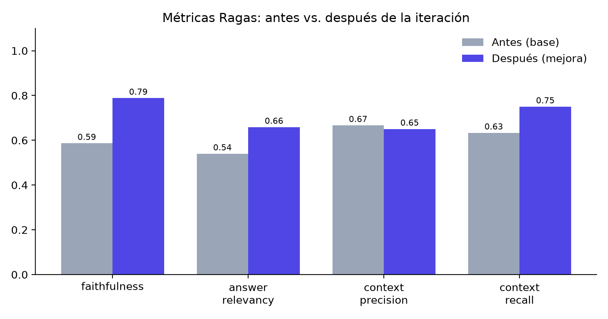

# 🧠 Asistente Experto basado en RAG

Asistente conversacional que responde **únicamente** con la información de una base de conocimientos propia y **cita la fuente** (documento y fragmento) de cada respuesta. Cuando la información no está en el corpus, lo dice en lugar de inventar.

En las consultas normales, primero explica la respuesta con citas del material recuperado y después hace una sola pregunta de seguimiento. Los quizzes y otras herramientas de estudio conservan el formato solicitado.

> **URL pública de la aplicación:** `https://TU-APP.streamlit.app`  ← *(reemplazar tras el despliegue)*
> **Repositorio:** <https://github.com/damoelrrr/rag-asistente>

**Privacidad:** el sistema conserva el control de la base de conocimientos y del índice vectorial. Los documentos no se entregan a servicios de entrenamiento; los embeddings se calculan **localmente** y al LLM solo se le envían los fragmentos recuperados para cada consulta, nunca el corpus completo.

---

## 1. Flujo RAG implementado

```
  Documentos (PDF/DOCX/TXT/MD/HTML)
        │  1. INGESTA          rag/ingest.py
        ▼
  Texto por página/documento
        │  2. CHUNKING         rag/chunking.py   (800 car., solape 120, corte recursivo)
        ▼
  Chunks + metadatos (fuente, página, nº de fragmento)
        │  3. VECTORIZACIÓN    rag/embeddings.py (paraphrase-multilingual-MiniLM-L12-v2, local)
        ▼
  Índice persistente Chroma (coseno)   rag/vectorstore.py   ──►  data/index/
        ▲
        │  5. RECUPERACIÓN     top_k + umbral de distancia
  Pregunta ──► 4. REESCRITURA con historial (preguntas de seguimiento)  rag/pipeline.py
        ▼
  6. GENERACIÓN: system prompt + few-shot + <contexto>…</contexto> + <pregunta>   rag/prompts.py
        ▼
  Respuesta con citas [n] + panel de fuentes   app.py
```

| Etapa | Decisión | Justificación |
|---|---|---|
| Corpus | 7 PDFs del curso *Desarrollo de aplicaciones con IA* (`data/corpus/`): Introducción a RAG, survey *RAG for LLMs* (Gao et al., 2024), TF-IDF y keyword search, BM25, ingeniería de prompts, LLMs locales con Ollama y método socrático | El asistente es un tutor del curso: el corpus cubre justo lo que el estudiante consulta (recuperación, RAG, prompting, LLMs locales y la pedagogía socrática del tutor). Mezcla diapositivas cortas en español con un artículo largo en inglés, lo que justifica un embedding multilingüe |
| Chunking | 800 caracteres, solape 120 (15 %), corte recursivo párrafo → línea → frase → palabra | Suficiente contexto para una idea completa sin mezclar temas; el solape evita cortar ideas en el límite |
| Embeddings | `paraphrase-multilingual-MiniLM-L12-v2` (384 dim) | Multilingüe (español), ligero, corre local y no envía texto a terceros |
| Índice | Chroma persistente, distancia coseno | Open source, embebido, guarda texto + metadatos para citar |
| Recuperación | Búsqueda híbrida: embeddings + BM25, expansión de siglas y fusión de rankings; `top_k=4`, distancia coseno máxima 0.75 | Recupera candidatos adicionales, descarta títulos aislados y bloques bibliográficos, y selecciona hasta 4 fragmentos para el modelo |
| Generación | LLM vía LangChain (Groq `openai/gpt-oss-120b` por defecto; también Anthropic u OpenAI), temperatura 0.1 | Respuestas estables y fieles al contexto |
| Conversación | Reescritura de la pregunta con el historial antes de buscar | Permite preguntas de seguimiento ("¿y su ventaja?") |

## 2. Instalación y ejecución (local)

Requisitos: Python 3.10–3.12 y una clave de API (Groq gratuita en <https://console.groq.com/keys>, o Anthropic/OpenAI).

```bash
python -m venv .venv
# Windows:  .venv\Scripts\activate        macOS/Linux:  source .venv/bin/activate
pip install -r requirements.txt
cp .env.example .env        # Windows: copy .env.example .env   → pega tu clave en .env
python scripts/build_index.py      # opcional: la app lo construye sola si no existe
streamlit run app.py
```

La primera ejecución descarga el modelo de embeddings (~470 MB). Abre `http://localhost:8501`.

Un **chunk** es un fragmento del documento, de hasta 800 caracteres y con hasta 120 caracteres de solapamiento. Hay 269 en el índice del corpus actual. Con `top_k=4`, la búsqueda examina al menos 32 candidatos (si el corpus tiene suficientes) y envía al modelo hasta 4 fragmentos que pasan el filtro de relevancia. La barra lateral permite cambiar ese máximo entre 1 y 8. Una respuesta sin contexto suficiente conserva las fuentes consultadas para poder inspeccionar lo que se recuperó.

## 3. Evaluación con Ragas

El conjunto de evaluación está en `eval/eval_questions.json`: **20 preguntas con respuesta de referencia**, 15 con respuesta en el corpus y 5 fuera de él (pgvector, precio de GPT-4o, Mundial 2018, CNN con PyTorch, Ley 1581) para medir el control de alucinaciones.

```bash
# Línea base
python eval/run_eval.py --tag base   --chunk-size 1000 --overlap 100 --top-k 2
# Iteración de mejora (chunks más pequeños, más solape y más fragmentos)
python eval/run_eval.py --tag mejora --chunk-size 800  --overlap 120 --top-k 4
# Tabla y gráfico comparativos
python eval/compare.py --before base --after mejora
```

LLM de generación: `openai/gpt-oss-120b`. Juez de Ragas: `openai/gpt-oss-20b` (ambos en Groq; usar modelos distintos reparte los límites del plan gratuito).

### Resultados

Estas métricas corresponden a las corridas guardadas `base` y `mejora`, anteriores a la búsqueda híbrida. Deben recalcularse para evaluar la recuperación actual.

| Métrica | Base (1000 / 100 / k=2) | Mejora (800 / 120 / k=4) | Cambio |
|---|---|---|---|
| faithfulness | 0.59 | 0.79 | +0.20 |
| answer_relevancy | 0.54 | 0.66 | +0.12 |
| context_precision | 0.67 | 0.65 | −0.02 |
| context_recall | 0.63 | 0.75 | +0.12 |
| Abstención fuera del corpus | 100 % | 100 % | = |
| Rechazos indebidos (preguntas con respuesta) | 33 % | 13 % | −20 pp |



**Análisis.**
- **Métrica más baja en la versión final: `context_precision` (0.65), que se atribuye a la recuperación.** Los fragmentos que solo contienen el título de una diapositiva ("MÉTODO BM25 - BEST MATCHING 25") y los párrafos del survey en inglés ocupan puestos del top_k y desplazan la diapositiva en español que tiene la respuesta (q03, q09, q11).
- **La generación es sólida.** Cuando llega el contexto correcto, faithfulness es 1.0 en casi todos los casos, y el asistente rechazó el 100 % de las preguntas fuera del corpus.
- **La iteración confirma la hipótesis.** Con más fragmentos y más pequeños sube context_recall, y las preguntas que antes se rechazaban por falta de contexto (q06, q14) ahora se responden. A cambio, entra algo más de ruido (precision −0.02).
- **Siguientes mejoras:** enriquecer los fragmentos cortos con contexto adyacente y añadir un re-ranker cross-encoder. La búsqueda híbrida BM25 + embeddings ya está implementada.
- **Nota:** en la corrida `mejora`, el límite diario de tokens de Groq dejó sin puntuar 7 de 60 evaluaciones (q13–q15). Comparando solo las 12 preguntas puntuadas completas en ambas corridas, la tendencia es la misma (recall 0.63 → 0.75, faithfulness 0.73 → 0.77, relevancy 0.58 → 0.64, precision 0.67 → 0.65).

Archivos: `eval/results/summary_<tag>.json`, `detalle_<tag>.csv` (respuesta, fragmentos y métricas por pregunta), `comparison.csv` y `docs/ragas_comparison.png`.

## 4. Despliegue (Streamlit Community Cloud)

1. Sube el repositorio a GitHub (sin `.env` ni `secrets.toml`; ya están en `.gitignore`).
2. En <https://share.streamlit.io> → **Create app** → elige repo, rama `main` y `app.py` como archivo principal.
3. En **Advanced settings** elige **Python 3.12** y en **Secrets** pega:
   ```toml
   LLM_PROVIDER = "groq"
   GROQ_API_KEY = "tu-clave"
   LLM_MODEL = "openai/gpt-oss-120b"
   ```
4. **Deploy**. El primer arranque tarda unos minutos: instala dependencias, descarga el modelo de embeddings y construye el índice a partir de `data/corpus/`.
5. Copia la URL pública y pégala arriba en este README.

Alternativas: Hugging Face Spaces (SDK Streamlit, secrets en *Settings → Variables and secrets*), Render o Railway (comando de inicio: `streamlit run app.py --server.port $PORT --server.address 0.0.0.0`).

### PDF de entrega

Con las capturas en `docs/screenshots/` (`01_…` a `06_…`) y los resultados de Ragas, se genera `docs/Entrega_Avance2.pdf`:

```bash
python scripts/build_deliverable_pdf.py --autor "Tu nombre" --curso "Tu curso" \
    --url https://TU-APP.streamlit.app --repo https://github.com/damoelrrr/rag-asistente
```

## 5. Estructura del repositorio

```
app.py                   Interfaz de chat (Streamlit)
rag/                     Pipeline: config, ingest, chunking, embeddings, vectorstore, prompts, llm, pipeline
data/corpus/             Documentos fuente (reemplázalos por los tuyos)
eval/                    eval_questions.json, run_eval.py (Ragas), compare.py, results/
scripts/                 build_index.py, build_deliverable_pdf.py
docs/                    PDFs, diagrama y capturas (docs/screenshots/)
```

## 6. Problemas frecuentes

- **`sqlite3` demasiado antiguo en la nube:** ya se maneja con `pysqlite3-binary` (ver inicio de `app.py`).
- **Ragas falla con `n` / `strictness` en Anthropic:** ejecuta con `RAGAS_STRICTNESS=1` o usa `JUDGE_PROVIDER=openai`.
- **Rechaza preguntas válidas:** sube `MAX_DISTANCE` (p. ej. 0.85). **Responde cosas fuera del corpus:** bájalo (p. ej. 0.6).
- **Cambiaste `CHUNK_SIZE` o el modelo de embeddings:** cada combinación crea su propio índice en `data/index/`.
